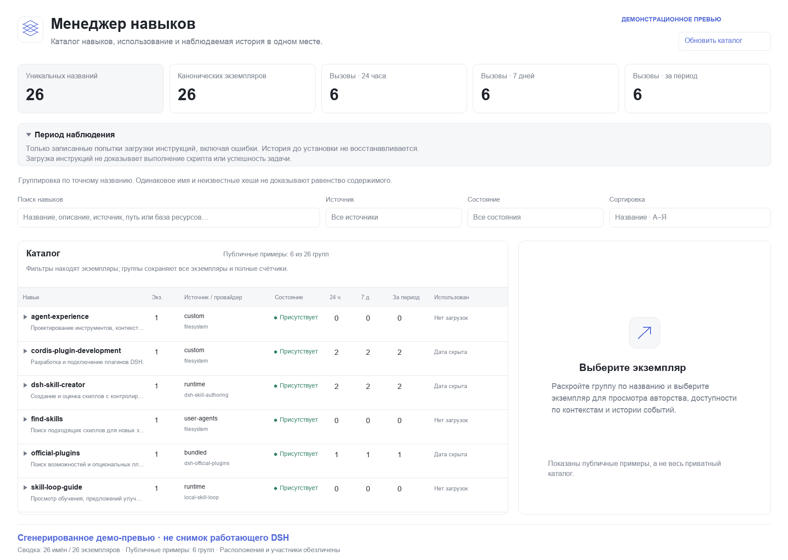
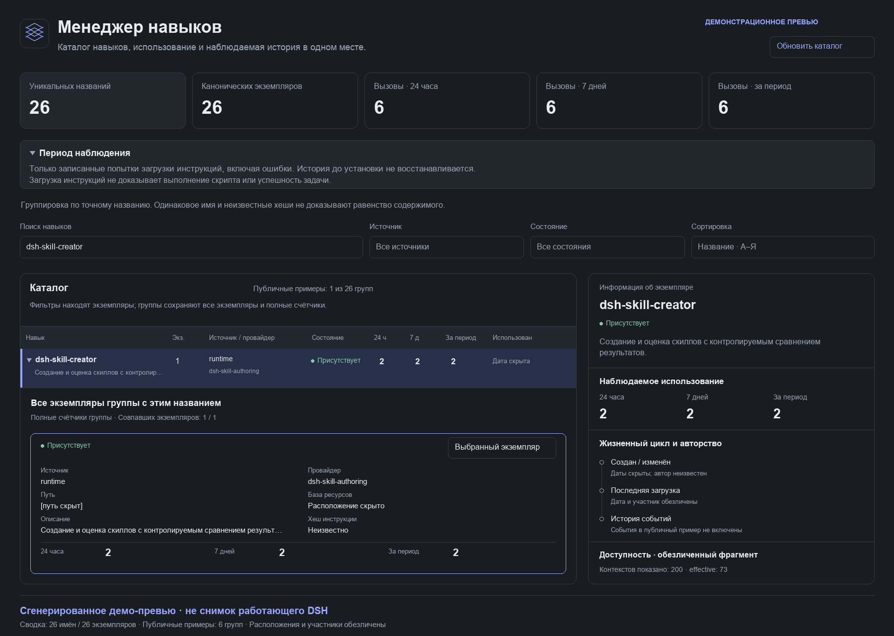

# DSH Skill Manager

Плагин `@pnpwin/dsh-skill-manager` для DeepSeek Harness: каталог скиллов, наблюдаемый жизненный цикл и статистика загрузки инструкций. Открывается отдельным полноэкранным приложением **Менеджер навыков** в боковой панели, рядом с LLM Quotas; не добавляет виджет к чату.

[GitHub](https://github.com/pnpwin/dsh-skill-manager) · [Релизы](https://github.com/pnpwin/dsh-skill-manager/releases) · [Как пользоваться](docs/USAGE.md) · [Управление скиллами](docs/MANAGEMENT.md) · [API](docs/API.md)

## Демонстрация оформления

**Ниже — сгенерированные демонстрационные превью, а не скриншоты работающего DSH.** Они подготовлены по структуре Client UI и обезличенным данным плагина; публичные примеры сокращены, пути и идентификаторы скрыты. Иллюстрации не заменяют визуальную проверку установленного приложения. На каждом изображении есть соответствующая пометка. Превью показывают базовый каталог 0.2; новые элементы управления 0.3 описаны в [отдельной инструкции](docs/MANAGEMENT.md).

### Каталог: группы по имени и общая статистика



### Раскрытая группа и подробности экземпляра



## Быстрый старт

1. В DSH Plugin Manager установите `github:pnpwin/dsh-skill-manager#v0.3.1`.
2. После обновления проверьте фактический API; при старом поведении полностью перезапустите DSH даже если Plugin Manager сообщил `applied`. Обновление страницы не заменяет закэшированный Host JavaScript.
3. Откройте **Менеджер навыков** в боковой панели, нажмите **Обновить каталог**.
4. Раскройте строку с именем, затем **Открыть этот экземпляр**, чтобы увидеть источник, доступность по scope, статистику и историю.

Пошаговое описание фильтров, счётчиков, неизвестного авторства и служебных eval-кандидатов — в [инструкции](docs/USAGE.md).

## Что работает

- Каталоги глобального registry, всех исправных agent presets и активных агентов, включая сохранённые scope старых ревизий preset. Проекты берутся из Workspace Registry, текущих рабочих директорий и `workspaceDirs`.
- Источники DSH: проектные `.dsh/skills`, `.agents/skills`, пользовательские директории DSH/Agents, `customSkillDirs` действующих filesystem providers, bundled/runtime/другие providers. Профильные композиции учитываются через preset scopes; отдельной несуществующей в DSH конвенции `<profile>/skills` плагин не придумывает.
- Состояние физического файла отдельно от доступности в каталогах; исчезновение provider/приоритета не считается удалением. Подтверждённые отсутствующие файлы остаются в истории. Неудачная/неполная проверка не означает удаление.
- Первое/последнее наблюдение, filesystem birthtime с явной отметкой источника, mtime, SHA-256 инструкции, изменения/исчезновение/восстановление, подтверждённые записи DSH tools с идентификатором агента/сессии. Неизвестный автор остаётся неизвестным.
- Вызовы модельного `skill`, вложенные PTC-вызовы и явная пользовательская инъекция `/skill-name`. Поиск, показ каталога, чтение manager API и `ctx.skills.get()` не увеличивают статистику.
- Скользящие интервалы последних 24 часов / 7 суток, все **записанные** попытки, последняя дата и инициатор. Ошибочные попытки учитываются; outcome и channel видны в истории. Повторные уведомления одного call ID не увеличивают счётчик.
- Каталог сгруппирован по точному имени: одна строка раскрывает все экземпляры с источниками, расположением, метаданными и отдельной статистикой. Счётчики различают уникальные имена и канонические экземпляры. Фильтры находят подходящий экземпляр, но оставляют все экземпляры найденной группы и полную статистику группы. Совпадающие непустые SHA-256 текущих instruction files отмечаются как идентичные копии; равенство имени или неизвестных хэшей этого не доказывает.
- Поиск, фильтры источника/состояния, сортировки, панель подробностей/истории; русский и английский интерфейс, темы DSH, пагинация по группам.
- Рабочий статус выбранного экземпляра: включение/выключение, включая bundled/plugin/runtime без изменения пакетных файлов. Для управляемых локальных файлов доступны архивирование, возврат и окончательное удаление с точной целью и подтверждением имени. Файловый журнал, expiring tokens, проверка изменившихся файлов и запрет перезаписи при возврате защищают от случайных потерь. История и счётчики сохраняются. [Действия и ограничения](docs/MANAGEMENT.md).

## Важные границы достоверности

**«Все записанные» не равно доказанному количеству за всю жизнь скилла.** Менеджер не импортирует старые сессии: считает наблюдения, пока плагин активен. Начало покрытия показано в приложении; периоды выключения, рестарта и до установки не восстанавливаются догадками. Загрузка инструкций не доказывает выполнение скрипта, успешность задачи или последующее применение скилла моделью без нового вызова.

Birthtime — время создания текущего filesystem-объекта, не исходное время написания скилла; копирование, checkout и восстановление могут его изменить. `createdBy` поэтому обычно неизвестен. `modifiedBy` связывается с текущей редакцией только при совпадении версии файла и положительного `fs/observed` от инструмента записи либо хэш-подтверждённого изменения политики через owner UI менеджера. Shell/IDE/Git не выдают достоверную личность редактора: такие изменения видны по хэшу, но автор не назначается.

Registry DSH отдаёт **победителей**, не все перекрытые одноимённые candidates. Плагин не читает приватные registry layers. Ранее увиденные файлы продолжают проверяться после потери приоритета; никогда не виденные перекрытые дубликаты не перечисляются. ID экземпляра зависит от provider/name/расположения: для файлов это нормализованный абсолютный путь, для виртуальных — канонический resourceBase, но **не contextId**. Scope и его отличающиеся метаданные хранятся отдельно в `availability`. Виртуальные определения одного provider/name без разных resourceBase считаются одним экземпляром; публичный registry не предоставляет более точного постоянного locator. Группировка по имени не объединяет разные экземпляры в одну логическую сущность. Если вызов невозможно однозначно связать с ранее наблюдённой записью, он сохраняется отдельной записью с источником `unknown`, а не приписывается случайному файлу. Даже однозначное сопоставление с текущим каталогом не является доказательством исторической редакции тела.

Изменения ресурсов `scripts/`, `references/`, `assets/` не версионируются: хэш относится только к instruction file. Для виртуальных providers доступны метаданные каталога и наблюдаемые вызовы, но filesystem-даты и хэш тела неизвестны. Удаление/перемещение файла не удаляет старую статистику; переезд на другой путь создаёт другой ID. Пока плагин выключен, промежуточные редакции восстановить нельзя.

## Установка

Требуются DSH **0.2.2-rc.1** и Node **24.9+**, встроенный `node:sqlite`. Проверено по исходникам 0.2.2-rc.1 и поставляемым runtime API; pre-stable API DSH изолированы в [адаптере](src/dsh-adapter.js). Публичная поставка — [GitHub-репозиторий](https://github.com/pnpwin/dsh-skill-manager) и версионированные [релизы](https://github.com/pnpwin/dsh-skill-manager/releases); публикация в npm не выполняется.

Установка через DSH **Plugin Manager → install bundle**, target `github:pnpwin/dsh-skill-manager#v0.3.1`. Начиная с 0.2.2 пакет не содержит install/prepare/prepack lifecycle-скриптов и не требует сборки при установке из GitHub: ESM-файлы уже готовы. Проверки запускаются явно перед публикацией (`npm run release:check`). Для архивной 0.2.1, где pnpm мог запросить разрешение на Git preparation, доступен предварительно собранный `.tgz` в GitHub Releases; автоматически разрешать заблокированные скрипты не следует. Эквивалентный вызов агентского инструмента:

```json
{"action":"install_bundle","target":"github:pnpwin/dsh-skill-manager#v0.3.1"}
```

Для разработки допустима установка локальной директории тем же инструментом. В HMR-профиле замена уже подключённого пакета может требовать `remove_bundle` с точным именем `@pnpwin/dsh-skill-manager`, затем установку GitHub-версии. Не удаляйте профиль или SQLite: Plugin Manager сохраняет пользовательскую patch-конфигурацию, данные и credential bindings; имя пакета и row ID `pnpwin-skill-manager` остаются прежними. Если новая установка не удалась после удаления dependency, явно восстановите предыдущий источник через Plugin Manager. В профиле без HMR следуйте возвращённому `nextStep`, не обходите требование остановить профиль. Файлы живого профиля вручную не редактируются; необходимость полного перезапуска определяется результатом операции.

После установки откройте **Менеджер навыков** в боковой панели. Нажатие **Обновить каталог** выполняет тот же `refresh()`, что агентский `skill_manager` и публичный service. При отсутствии browser control факт установки не подтверждает визуальную проверку.

## Обновление до 0.3

Схема SQLite становится **3**, идентичность остаётся **2**. История и вызовы сохраняются; новые действия не выполняются автоматически при обновлении. Старый 0.2 не откроет эту базу для downgrade без согласованного backup. После успешной установки обновите существующую страницу, чтобы загрузить новые элементы Client. [Подробности обновления](docs/upgrade-0.3.md).

## Обновление с 0.1.x

В 0.2.0 исправлена scope-зависимая идентичность. При первом открытии SQLite v1 автоматически и транзакционно переводится в v2: раздробленные виртуальные строки объединяются, а вызовы, исходные event keys, история и привязки к scope сохраняются. Старые ID становятся aliases для `detail(oldId)`; ID файлов не меняются. При ошибке миграция откатывается, база не сбрасывается. Обратное открытие v2 старым плагином запрещено — для downgrade нужна заранее сделанная согласованная резервная копия. Не запускайте одновременно старый и новый writers одного профиля.

Для уже подключённого локального пакета **полностью перезапустите DSH**, а не только обновите вкладку: свежий Host выполнит миграцию и отдаст новый Client с группами. Не удаляйте SQLite и не переустанавливайте профиль. Подробнее: [изменения идентичности](docs/upgrade-0.2.md).

## Конфигурация

Настройки находятся в config строки этого плагина; значения задаются до активации и валидируются Standard Schema v1. Конфигурационные каталоги DSH, ожидающие исключительно native Schemastery graph, могут не показывать автоматическую форму; сам Cordis валидирует настройки. Добавочные директории скиллов подключайте **к filesystem provider DSH** через его `customSkillDirs`, а не к manager: manager не добавляет каталоги в registry. Его собственные подтверждённые ограничения вызова и файловые действия описаны [отдельно](docs/MANAGEMENT.md).

| Поле | По умолчанию | Назначение |
|---|---:|---|
| `workspaceDirs` | `[]` | Дополнительные абсолютные cwd для проектных каталогов; добавляются к Workspace Registry и активным агентам |
| `databasePath` | profile-local data | Необязательный абсолютный путь SQLite; не путь к каталогу скиллов |
| `scanIntervalMs` | `60000` | Фоновая проверка каталогов и instruction files, даже когда приложение закрыто |
| `scanTimeoutMs` | `30000` | Deadline ответа сканирования; поздний результат отбрасывается, provider получает AbortSignal |
| `debounceMs` | `750` | Объединение сигналов изменения |
| `maxContexts` | `256` | Предел combinations scope × cwd; превышение явно показано предупреждением |
| `maxFileBytes` | `1048576` | Предел хэшируемого instruction file; большой файл остаётся present без хэша |
| `observationCacheSize` | `4096` | Ограничение transient dedup/pairing/buffer; постоянный dedup хранится в SQLite |
| `additionalFilesystemProviders` | `[]` | Дополнительные имена известных filesystem providers, понимающих YAML-флаги вызова |
| `protectedSkillDirs` | `[]` | Дополнительные абсолютные каталоги, запрещённые для файловых изменений; встроенные пакетные запреты не снимаются |
| `actionTokenTtlMs` / `actionMaxPlans` | `120000` / `128` | Срок подтверждения и предел подготовленных планов |
| `actionMaxFiles` / `actionMaxBytes` | `10000` / `67108864` | Предел файлов/байтов проверяемой физической цели |
| `policySyncTimeoutMs` / `policyMaxAgents` | `10000` / `1024` | Deadline применения политики и предел управляемых agent scopes; превышение отклоняется явно |

Профильные данные находятся в `<profileContext.dir>/data/skill-manager/skills.sqlite`; запасной источник directory — `DSH_PROFILE_DIR`, а без профиля — `<DSH_HOME или ~/.dsh>/data/skill-manager/skills.sqlite`. База не создаётся внутри пакета. WAL, транзакции, монотонный `user_version=3` (0.3 добавляет журнал управления, не меняя ID/вызовы); неизвестная новая версия/повреждение не сбрасываются автоматически. Файл SQLite создаётся с mode 0600, каталог — 0700 (POSIX); учитывайте также наследуемые ACL вашей ОС. Перед переносом копируйте базу только после остановки плагина, включая согласованный WAL либо SQLite backup.

## Интерфейс для curator / self-improve

Стабильная поверхность — **Cordis service `skillManager`, API v1**, не внутренние SQL-таблицы. См. [API](docs/API.md). `./api` экспортирует service key/version/helper и TypeScript declarations. Методы: `snapshot()`, `refresh()`, `detail(id, pagination)`, `subscribe(listener)`; уведомление DSH `skill-manager/change` после commit. HTTP v1 и agent tool используют те же операции. `snapshot()` сохраняет плоский `skills` (экземпляры) и добавляет `groups` (группы по имени), `identityVersion: 2`; сумма usage групп не удваивает вызовы после миграции. Этот интеграционный service и agent tool остаются read/refresh-only: не выдают подтверждений, не редактируют скиллы и не запускают их код. Новые действия доступны только отдельным owner-authenticated маршрутам интерфейса; `management` в записи — оценка возможностей, не разрешение выполнить изменение. Менеджер не повышает sandbox/credential-разрешения и не записывает экспериментальные Session events.

Curator может наблюдать изменения и собирать кандидатов улучшения, self-improve — сопоставлять результаты с usage. Обучение/оценка качества/авторизация изменений остаются отдельными плагинами; счётчик популярности не считается оценкой качества.

## Безопасность и данные

Нет сетевых запросов к провайдерам, телеметрии, поиска credentials или чтения приватных профильных конфигураций. В базе — разрешённые registry metadata, пути/идентификаторы сессий, actor metadata, хэши и события; **не** instruction bodies, prompts, tool output content или raw session logs. Пути, описание и session IDs сами могут быть чувствительными: API доступен только owner-authenticated маршрутам существующего DSH connection; отдельный открытый webserver не запускается. Один профиль имеет один manager service; SQLite разрешает безопасную конкуренцию writers, но два процесса профиля дают два независимых источника наблюдений и не гарантируют полное покрытие друг друга.

## Разработка и проверки

Все executable sources находятся в `src/`, тесты — `tests/`. Для исходного checkout сначала выполните `npm ci --ignore-scripts` (нужен YAML parser). Нативный ESM не нуждается в трансляции; `npm run build` проверяет синтаксис, exports, layout, locale и display resources. `npm test` проверяет обнаружение scopes/отмену/lease disposal, дедуп tool/PTC/user событий, авторство, границы rolling windows, SQLite reopen, tombstones, ошибки и teardown. Дополнительно проверяются реальные временные файловые операции, owner-протокол, CAS/сбой журнала, no-file policy plans и SDK-пути native/PTC/user loading. SDK-тесты используют built DSH из `DSH_REFERENCE_ROOT` либо соседнего reference checkout; без него явно пропускаются. Они не выполняют платные model calls и не меняют реальные скиллы. `npm pack --dry-run --json` проверяет фактический список публикуемых ресурсов. Исследование, источники и отложенные возможности: [research](docs/research.md).

## Известные ограничения и следующие шаги

- Явный импорт **доступной** истории через публичный `sessionQuery`/Session projections с исключением fork-inherited событий и persistent import checkpoints; это сможет расширить покрытие, но не восстановит удалённые логи или неизвестные личности.
- Внешний журнал авторства от curator с evidence/version; Git metadata отдельно как recorded commit author, не фактический редактор. Произвольный интеграционный write/authorization API потребует отдельного major/design; owner UI 0.3 не выдаёт такие полномочия curator-агентам.
- Candidate enumeration потребует публичного extension point в DSH либо добровольных provider adapters; monkey-patching реестра не используется.
- Filesystem version equality адаптирована под `fs-local` 0.2.2 metadata tokens. Remote filesystem writers, версии из иных backends и shell edits не получают ложную атрибуцию.
- Deadline завершает запрос и не блокирует выгрузку manager даже при игнорировании AbortSignal. До завершения старой provider-операции новый scan не запускается, чтобы не накапливать leases; старый lease освобождается её собственным finally. Поздние результаты не обращаются к закрытой базе.

Иконка — оригинальная SVG-графика этого пакета, MIT.
