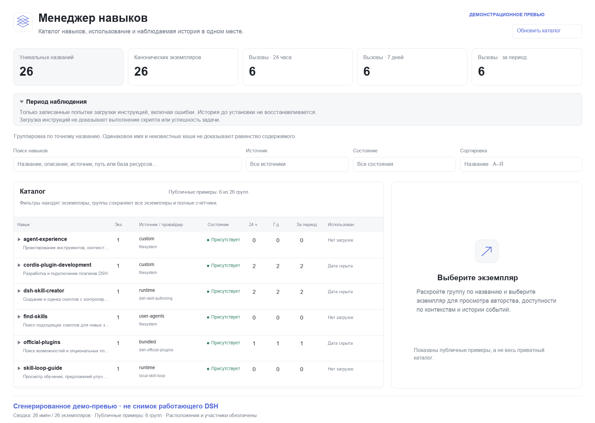
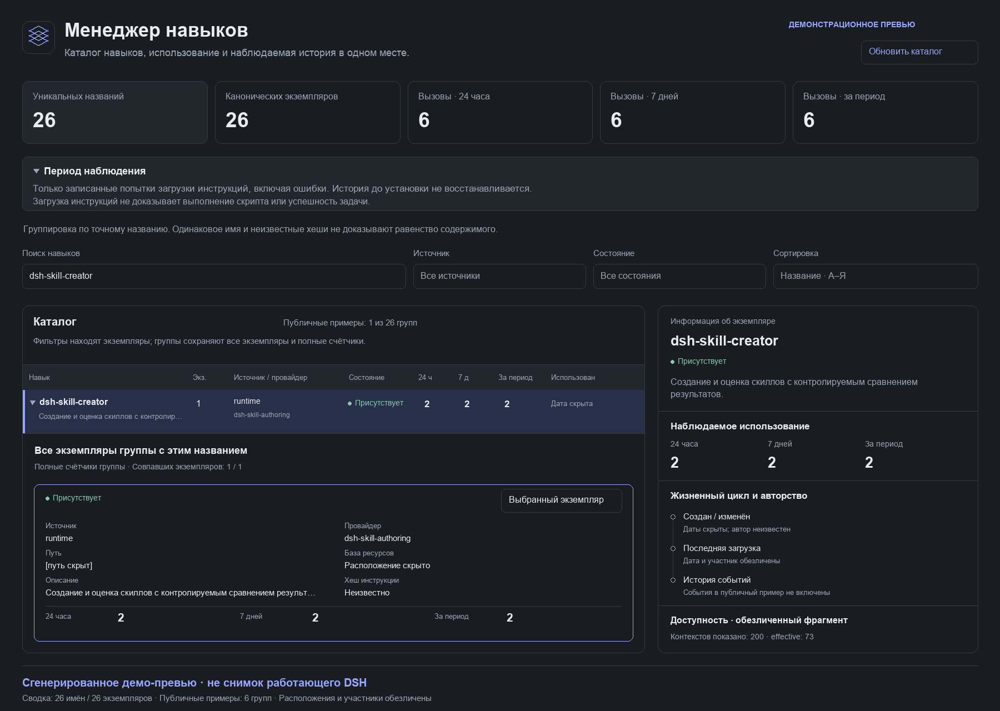

# Как пользоваться Skill Manager

Плагин `@pnpwin/dsh-skill-manager` показывает каталог, наблюдаемые загрузки инструкций и историю экземпляров навыков. Он не устанавливает навыки и не запускает их скрипты. Начиная с 0.3 выбранным экземпляром можно управлять через подтверждаемые owner-действия: включение/выключение для bundled/plugin тоже, а для безопасно управляемых локальных файлов — архивирование, возврат и удаление. См. [инструкцию управления](MANAGEMENT.md).

## Открыть приложение

1. Установите или включите пакет через **Plugin Manager** согласно [инструкции установки](../README.md). GitHub-релиз: `github:pnpwin/dsh-skill-manager#v0.3.0`.
2. Откройте **Менеджер навыков** в боковой панели DSH. Это отдельное полноэкранное приложение, не виджет внутри чата.
3. Дождитесь получения каталога. Если есть предупреждения неполного обнаружения или ошибки чтения, учитывайте их до выводов об отсутствии навыка.

### Иллюстрации интерфейса

Ниже — **сгенерированные демонстрационные превью на основе обезличенных данных плагина**, а не снимки работающего DSH. Компоновка иллюстративна; изображения не подтверждают визуальную проверку установленного приложения. Пути, участники, идентификаторы сессий и чувствительные метаданные не публикуются.





## Имена, экземпляры и контексты — разные вещи

- **Уникальные названия** — число групп по точному имени. Одна строка каталога соответствует одному имени; одинаковое имя само по себе не доказывает одинаковое содержимое или общую логическую сущность.
- **Канонические экземпляры** — отдельные определения по provider/name/расположению. Для файлов расположение определяется путём, для виртуальных навыков — `resourceBase`. Разные физические копии могут быть разными экземплярами.
- **Контексты доступности** — scope/preset/рабочие директории, где экземпляр наблюдался. Один виртуальный навык не размножается в экземпляры только из-за нескольких контекстов. Отличающиеся метаданные контекстов сохраняются отдельно.

Раскройте имя стрелкой или нажатием на название. Приложение покажет **все экземпляры группы**: источник, провайдер, путь или базу ресурсов, состояние, описание, хеш и отдельные счётчики. Нажмите **Открыть этот экземпляр**, чтобы увидеть его жизненный цикл и историю.

Метка одинакового содержимого появляется только у подтверждённых присутствующих файлов с совпавшим известным SHA-256 инструкции. `null`/неизвестный хеш не считается совпадением. Хеш относится к instruction file, а не ко всему набору `scripts/`, `references/` или `assets/`. Метка **Метаданные различаются** предупреждает о различиях экземпляров или их эффективных scope-вариантов.

## Поиск, фильтры и счётчики

Поиск проверяет имя, описание, источник, провайдер, путь, идентификатор и поля базы ресурсов, включая сохранённые метаданные контекста. Фильтры источника и состояния применяются к экземпляру; совпадение разных фильтров не собирается из разных экземпляров.

**Если подходит хотя бы один экземпляр, показывается вся группа.** Её счётчики остаются полными, а не превращаются в сумму только отфильтрованных экземпляров. При раскрытии видны все копии и отметки совпадения с фильтрами. Сортировка и страницы относятся к группам; верхние счётчики описывают весь каталог.

Вызовы за **24 часа**, **7 суток** и **за весь записанный период** — наблюдаемые попытки загрузки инструкций, включая ошибки. Интервалы скользящие, не календарные. Ноль означает отсутствие записанных попыток в покрываемом периоде, а не доказательство неиспользования.

Поиск и чтение менеджера не увеличивают счётчики. Загрузка инструкций не доказывает выполнение скрипта, успешность задачи или качество навыка. История до установки и промежутки выключения автоматически не восстанавливаются. Начало покрытия и пояснения находятся в блоке **Период наблюдения**.

## Жизненный цикл экземпляра

В панели подробностей смотрите:

- **Создан** — filesystem birthtime, если он доступен. Копирование и checkout могут изменить эту дату; это не доказательство первоначального авторства.
- **Последнее изменение** — наблюдаемая информация о файле. Автор связывается с редакцией только по подтверждённому событию записи и совпадению версии; shell/IDE/Git не получают выдуманную личность автора.
- **Впервые обнаружен / последнее наблюдение** — даты наблюдения, не даты создания.
- **Последняя загрузка** и история `invocation` — попытки вызова с известным инициатором, `outcome` и `channel`. Ошибка остаётся ошибкой, а не успешным применением.
- **Доступность по контекстам** — effective/not effective и сохранённые source/description/invocation/resourceBase конкретного контекста, когда эти поля предоставлены.

**Неизвестно** — содержательный результат, а не пропуск, который следует заполнить догадкой. Событие обнаружения не означает создание. Потеря доступности в scope не означает удаление файла. Физическое состояние и доступность в каталоге показываются раздельно; уже наблюдавшаяся история сохраняется.

Для виртуальных навыков отсутствие файловых дат и хеша нормально. Временный `context-service` evaluation-плагина может предоставлять виртуального кандидата в отдельном scope. Такой кандидат виден только тогда, когда его scope действительно доступен через перечисляемый публичный registry активного агента или preset; manager не вскрывает произвольные приватные context-service. Для обнаруженного кандидата доступность отражает наблюдённые контексты; после исчезновения scope история экземпляра сохраняется, а доступность обновляется при успешном полном сканировании. Временный контекст не создаёт новый экземпляр одного и того же определения. Manager не оценивает кандидата и не превращает популярность в оценку качества: для этого нужен отдельный потребитель публичного service.

### Почему виден `eval-candidate-*`

Это временная runtime-регистрация провайдера `dsh-skill-authoring-evaluation`, а не отдельный установленный файл. Если manager успел наблюдать её тестовый scope, запись останется в истории после завершения оценки и станет недоступной. Основной каталог пока не выделяет такие записи в отдельную служебную категорию. Чтобы убрать завершённые тестовые регистрации из текущего вида, выберите состояние **Присутствует**; это только фильтр, история не удаляется. Не считайте такую запись доказательством того, что скилл был опубликован или постоянно установлен.

## Обновить каталог или перезапустить DSH?

**Обновить каталог** повторно запрашивает доступные registry/scopes и проверяет известные instruction files. Та же операция доступна агенту и API. Она не переустанавливает пакет, не меняет конфигурацию provider и не загружает новую версию Host-кода.

После обновления пакета через Plugin Manager следуйте возвращённому статусу установки. Если требуется restart, **полностью перезапустите DSH**; обновление вкладки браузера не заменяет перезапуск Host. Для обновления с 0.1.x важна [миграция идентичности](upgrade-0.2.md): не удаляйте SQLite ради устранения дубликатов и не запускайте одновременно старый и новый writer. Настройки и данные профиля не следует редактировать вручную.

При ошибке обновления приложение может сохранить последний успешный снимок и явно показать, что данные устарели. Повторите запрос после устранения причины; предупреждения и неизвестные значения не следует скрывать ради красивой статистики.

## Агентский инструмент

Получить экземпляры по имени, не загружая их инструкции:

```json
{"action":"list","search":"example-skill","limit":20}
```

Передайте возвращённый `id` в подробности:

```json
{"action":"detail","id":"<id из результата list>","offset":0,"limit":30}
```

Запустить повторное сканирование:

```json
{"action":"refresh"}
```

Это параметры инструмента **`skill_manager`**. Его `list` остаётся постраничным списком экземпляров для совместимости; это не страница групп интерфейса. Инструмент только читает/обновляет индекс, не редактирует инструкции и не разрешает выполнение кода.

## API для curator / evaluation / self-improve

Потребитель внутри DSH использует публичный Cordis service, а не SQLite или приватные поля registry:

```js
import { getSkillManager } from '@pnpwin/dsh-skill-manager/api';

export const inject = ['skillManager'];
export function apply(ctx) {
  const manager = getSkillManager(ctx);
  ctx.effect(() => manager.subscribe(() => {
    const { groups, skills, coverage, warnings } = manager.snapshot();
    // Ваша политика оценки: учитывайте coverage/warnings и неизвестные поля.
    // groups — представление по имени, skills — канонические экземпляры.
  }));
}
```

Не ожидайте `refresh()` внутри Host `apply`: перечисление preset может ждать завершения загрузки Host. Уведомление означает изменение индекса, не автоматическое разрешение улучшать или публиковать навык.

Через существующее owner-authenticated соединение DSH доступны:

```text
GET  /api/skill-manager/v1/snapshot
POST /api/skill-manager/v1/refresh
GET  /api/skill-manager/v1/skills?id=<id>&offset=0&limit=30
```

Не открывайте отдельный публичный сервер и не публикуйте реальные пути, session IDs или содержимое приватного каталога. Подробные схемы, границы атрибуции и значения состояний — в [API v1](API.md).

## Воспроизвести демонстрационные превью

Генератор [generate_previews.py](../src/docs/generate_previews.py) принимает **заранее очищенный** JSON, использует Pillow и не обращается к DSH, сети или браузеру:

```sh
python src/docs/generate_previews.py --input src/docs/preview-data.json --output docs/images
```

Выполняйте команду из корня пакета. При необходимости передайте шрифт с кириллицей через `--font` и `--font-bold`. Скрипт не должен получать сырой приватный snapshot: используйте только разрешённые публичные названия/описания, обезличенные счётчики и отсутствующие либо явно удалённые чувствительные метаданные. Публичный пример [preview-data.json](../src/docs/preview-data.json) содержит только проверенную обезличенную выборку; приватный исходный каталог в пакет не включается. Обе PNG содержат видимую пометку, что это сгенерированное демо, а не снимок работающего DSH.
